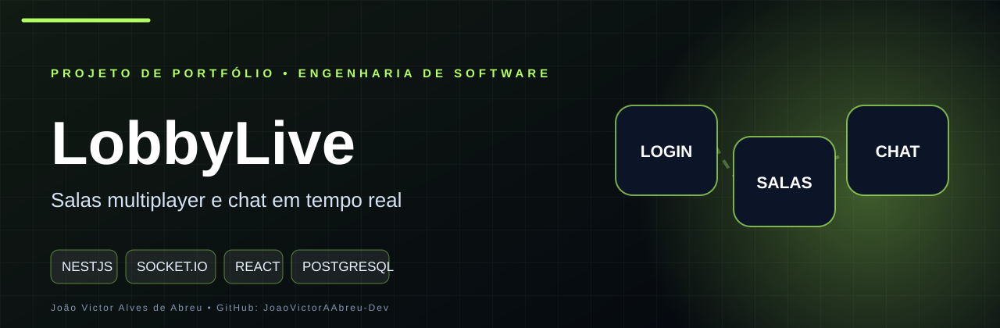
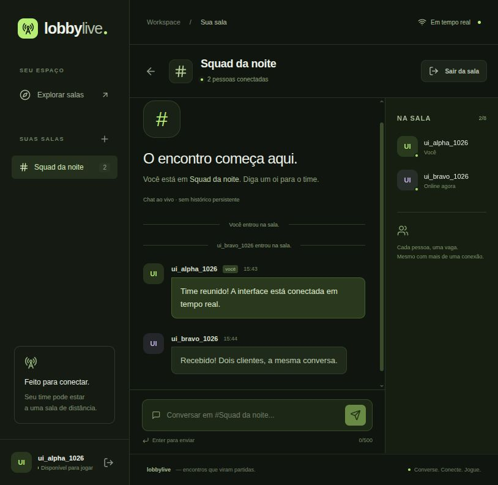
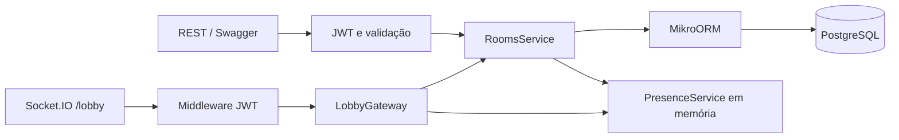
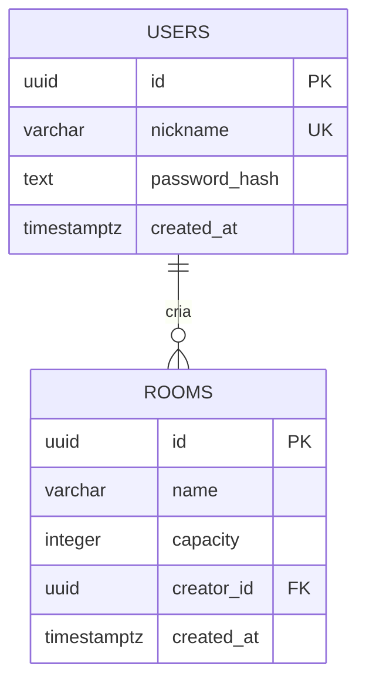

<p align="center">
  
</p>

# LobbyLive

[](https://github.com/JoaoVictorAAbreu-Dev/lobbylive/actions/workflows/ci.yml)

Aplicação de salas multiplayer com **frontend React, JWT, presença por conta e chat em tempo real**. A interface e os clientes de terminal usam o mesmo backend real.

**Stack:** Node.js 24, NestJS 11, TypeScript, Socket.IO 4, MikroORM 7.2, PostgreSQL 17, Docker, Jest e Supertest.

**Validação:** 41 testes aprovados localmente, demonstração com dois clientes em Docker e [CI remota aprovada](https://github.com/JoaoVictorAAbreu-Dev/lobbylive/actions/runs/40374750353).

## Rodar em poucos comandos

Pré-requisitos: Node.js 24, Docker Engine e plugin Docker Compose.

```bash
npm ci --ignore-scripts
npm run env:init
docker compose up --build -d --wait
# Abra http://localhost:3003
# Demonstração alternativa pelo terminal:
npm run demo
```

`env:init` gera um segredo JWT aleatório em `.env` com permissão `0600`; não imprime seu valor e preserva um arquivo existente. `.env` nunca é versionado. A imagem requer um segredo de pelo menos 32 bytes.

- **[Interface web](http://localhost:3003)** — cadastro, login, salas, participantes e chat.
- [Swagger REST](http://localhost:3002/docs)
- [OpenAPI JSON](http://localhost:3002/docs-json)
- REST: `http://localhost:3002/api/v1`
- Socket.IO: URL `http://localhost:3002/lobby`, caminho `/socket.io`
- [Contrato dos eventos](docs/EVENTS.md)
- [Evidências locais e remotas](VALIDACAO.md)

O Compose independente chama-se `lobbylive`. O banco usa a porta local **5434** e a API **3002**, sem interferir nas portas do GameScore. O PostgreSQL precisa ficar saudável; em seguida `migrate` aplica as migrations e termina com código 0; só então a API inicia. `Exited (0)` é o estado normal de `migrate`.

A API roda como usuário `node`, sem root; portas são publicadas somente em `127.0.0.1`. O volume `postgres_data` conserva usuários e salas. `docker compose stop` e `docker compose start` não apagam os dados. Não execute `down -v` se precisar preservá-los.

## Interface web



Abra **http://localhost:3003** após iniciar o Compose. Crie uma conta, crie ou escolha uma sala e envie mensagens. Abra outra aba e entre com outra conta para observar presença, chat e saída em tempo real.

A interface usa React/TypeScript e Vite em `web/`. Um Nginx no Compose entrega os arquivos e encaminha `/api` e `/socket.io` à API, mantendo a mesma origem e suportando upgrade WebSocket. O contrato do backend permanece intacto.

A sessão e o token ficam **apenas na memória de cada aba**; recarregar exige novo login. Nenhum segredo JWT do servidor é enviado à interface. Ao perder conexão, as associações e mensagens locais são limpas. Use **Reconectar** e entre novamente nas salas. A interface não faz reenvio automático de mensagens sem confirmação; em caso de timeout, verifique a conversa antes de tentar novamente.

O diretório é paginado; a busca filtra a página atual. **Atualizar** busca salas e contagens novamente. A presença das salas abertas é atualizada por eventos em tempo real. Mensagens locais são limitadas às 300 entradas mais recentes por sala e não são um histórico persistente.

Para desenvolvimento com proxy Vite:

```bash
npm --prefix web ci --ignore-scripts
npm run web:dev
# http://localhost:5173 — requer API em http://127.0.0.1:3002
npm run web:build
```

O layout possui regras responsivas, foco visível, labels nos formulários, diálogo modal e avisos de erro. Não inclui voz, upload de arquivos ou notificações fora da aba.

## Demonstração de dois clientes

`npm run demo` faz chamadas REST reais para criar duas contas sintéticas e uma sala. Conecta dois clientes Socket.IO, verifica entrada, snapshot, chat e saída com acknowledgements e timeouts. O processo retorna código diferente de zero em caso de falha.

O script gera senhas temporárias aleatórias, não imprime tokens/senhas e desconecta os clientes ao terminar. Os usuários e a sala sintéticos continuam no banco; cada execução usa nicknames novos. Não há exclusão automática.

Para outro endereço, use `LOBBY_URL=http://localhost:3002 npm run demo`.

Para interação manual com dois terminais, faça login no Swagger, crie uma sala e use `npm run client` em cada terminal com `LOBBY_TOKEN` no ambiente. Veja [os comandos e a configuração](docs/EVENTS.md#cliente-interativo).

## Contrato REST

Prefixo `/api/v1`. Todas as respostas usam JSON.

| Método | Endpoint | Acesso | Resposta |
|---|---|---|---|
| POST | `/auth/register` | Público | `201`, conta sem hash |
| POST | `/auth/login` | Público | `200`, accessToken, tokenType e expiresIn |
| GET | `/auth/me` | Bearer JWT | Conta autenticada |
| POST | `/rooms` | Bearer JWT | `201`, sala criada |
| GET | `/rooms` | Bearer JWT | Lista paginada de salas |
| GET | `/rooms/:id` | Bearer JWT | Sala e quantidade de contas presentes |
| GET | `/health` | Público | Estado da API e conexão com PostgreSQL |

Exemplos de corpos JSON:

```json
{ "nickname": "player_one", "password": "Uma-senha-sintetica-123!" }
```

```json
{ "name": "Partida da noite", "capacity": 8 }
```

A senha acima é apenas um exemplo sintético. O Swagger aceita o token no botão **Authorize**, sem necessidade de prefixar `Bearer` manualmente.

- Nickname: trim/minúsculas, 3–30 caracteres, somente `a-z`, `0-9` e `_`, com unicidade no banco.
- Senha: 12–128 caracteres; Argon2id com 64 MiB, 3 iterações e paralelismo 1, usando salt aleatório gerado pela biblioteca.
- JWT: HS256, validade de uma hora, emissor e audiência `lobbylive`, identificador da conta no `sub`. O servidor consulta a conta e não confia em nomes enviados por eventos.
- Nome de sala: trim, 3–60 caracteres. Nomes podem repetir; identificação pelo UUID.
- Capacidade: inteiro entre 2 e 16, padrão 8. Strings numéricas e `null` são rejeitados.
- Campos desconhecidos, UUIDs e paginação inválidos são rejeitados.
- Listagem: `page=1`, `limit=20`, máximo 100; página máxima 1.000.000. Ordenação `createdAt DESC, id DESC`.

```json
{ "data": [], "total": 0, "page": 1, "limit": 20 }
```

O detalhe de sala contém `id`, `name`, `capacity`, `participantCount`, `creator: { id, nickname }` e `createdAt`. A contagem é de **contas ativas distintas**, sem incluir reservas ainda não confirmadas. Não expõe hashes ou lista de participantes; essa lista exige participação via Socket.IO.

Erros HTTP:

```json
{ "statusCode": 401, "code": "UNAUTHORIZED", "message": "Token inválido ou expirado." }
```

| Status | Código | Condição |
|---|---|---|
| 400 | `VALIDATION_ERROR` | Corpo, UUID ou query inválidos; inclui `details` quando aplicável |
| 401 | `INVALID_CREDENTIALS` | Login inválido, sem distinguir conta inexistente |
| 401 | `UNAUTHORIZED` | Token ausente, inválido ou expirado |
| 404 | `ROOM_NOT_FOUND` | Sala inexistente |
| 409 | `NICKNAME_TAKEN` | Nickname duplicado |
| 503 | `DATABASE_UNAVAILABLE` | Health sem banco |
| 500 | `INTERNAL_ERROR` | Falha inesperada, sem detalhes internos na resposta |

## Arquitetura e consistência





A presença não é uma tabela. Para cada sala, um mapa de contas mantém conjuntos de conexões pendentes e ativas. A reserva síncrona consome capacidade antes de aguardar o adaptador; somente o commit torna a conta visível. Falhas desfazem a reserva. A primeira conexão ativa emite entrada; a última saída emite saída. Comandos da mesma conexão são serializados, evitando ultrapassagem entre operações assíncronas.

O MikroORM usa contexto por requisição HTTP, por handshake e por comando Socket.IO que consulta o banco. Não há compartilhamento do identity map global entre operações. Migrations são explícitas; não há sincronização automática de schema.

## Desenvolvimento e testes

```bash
npm ci --ignore-scripts
npm run env:init
docker compose up -d --wait db
npm run migration:up
npm run start:dev
```

```bash
npm run lint
npm run typecheck
npm run build
npm test -- --runInBand

docker compose --profile test up -d --wait test-db
DB_HOST=127.0.0.1 DB_PORT=5435 DB_USER=lobbylive DB_PASSWORD=lobbylive_test \
  TEST_DB_NAME=lobbylive_test npm run test:e2e
```

Os testes E2E criam um servidor HTTP real em porta aleatória e clientes reais `socket.io-client`. PostgreSQL real valida migrations e autenticação; não há repositórios simulados. `TEST_DB_NAME` deve terminar em `_test`. As tabelas dessa base exclusiva são limpas entre os casos; não aponte os testes para dados importantes.

`test-db` usa tmpfs separado do volume da aplicação. A suíte usa um segredo JWT aleatório próprio, sem reutilizar o segredo local. Testes negativos de isolamento e ausência de replay usam janelas curtas de observação; testes positivos registram listeners antes da emissão, sem sleeps arbitrários.

Scripts adicionais: `migration:pending`, `migration:create`, `migration:up:prod`. `migration:down` desfaz a migration e **remove dados** na migration inicial; não faz parte do fluxo normal.

A CI executa lint, typecheck, build, testes unitários/REST/Socket.IO com PostgreSQL 17 e builds Docker da API e da interface. A CI também instala e compila `web/`. Confira a execução atual na [página do workflow](https://github.com/JoaoVictorAAbreu-Dev/lobbylive/actions/workflows/ci.yml).

## Limites desta versão

- **Uma instância da API**, sem Redis/adaptador distribuído. Não escalar réplicas com este controle de presença em memória.
- Usuários e salas persistem; presença e mensagens não. Ao reiniciar a API, todas as salas ficam vazias.
- Reconexão exige novo handshake válido e entradas explícitas; não há replay, histórico de chat ou deduplicação de mensagens reenviadas.
- Saída voluntária é imediata. Perda de rede é detectada pelo heartbeat do Socket.IO; limpeza acontece quando o servidor detecta a desconexão.
- Todas as salas são acessíveis às contas autenticadas. Não há convites, moderação, exclusão/edição, refresh token, recuperação de senha ou revogação.
- JWT expirado desconecta o cliente e limpa sua presença. Sem callbacks, erros de comando chegam em `operation:error`.
- Repositório público de portfólio, **sem hospedagem pública**. Não inclui controles operacionais de produção como recuperação de conta ou limitação de abuso.

As versões resolvidas estão em `package-lock.json`. Overrides de `multer` e `js-yaml` aplicam correções compatíveis na mesma versão principal; revisar ao atualizar NestJS.

Referências oficiais: [NestJS Gateways](https://docs.nestjs.com/websockets/gateways), [NestJS JWT](https://docs.nestjs.com/security/authentication), [Socket.IO rooms](https://socket.io/docs/v4/rooms/), [middleware](https://socket.io/docs/v4/middlewares/), [garantias de entrega](https://socket.io/docs/v4/delivery-guarantees), [MikroORM/NestJS](https://mikro-orm.io/docs/usage-with-nestjs).
